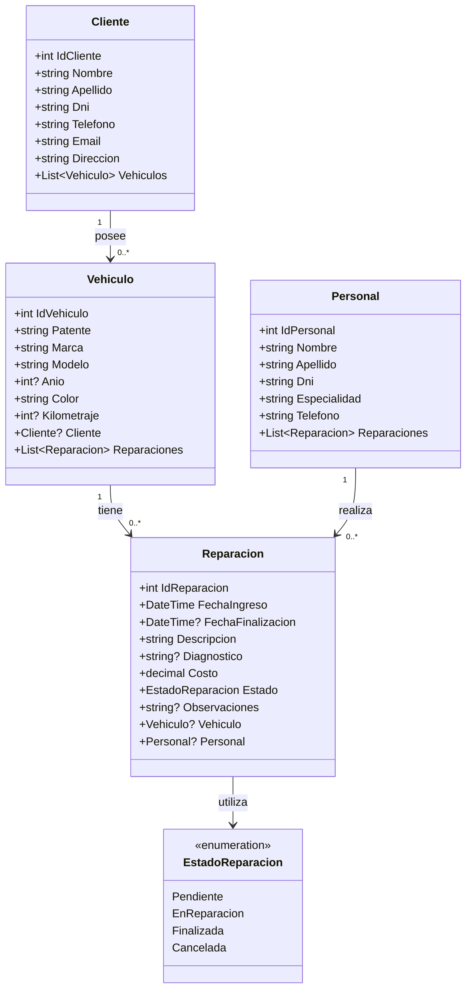

# UML — Modelo de dominio

Este diagrama representa las entidades principales del sistema Autos Varela, sus atributos y las relaciones entre ellas.

## Descripción

- **Cliente:** contiene los datos de los clientes y sus vehículos.
- **Vehiculo:** representa los vehículos registrados y sus reparaciones.
- **Personal:** contiene los datos de los empleados del taller.
- **Reparacion:** registra los trabajos realizados, sus fechas, costos, estados y responsables.
- **EstadoReparacion:** enumeración con los estados Pendiente, EnReparacion, Finalizada y Cancelada.

Las multiplicidades representan las asociaciones de negocio establecidas durante el registro mediante los servicios. Las propiedades de navegación anulables permiten referencias nulas en los objetos C#.

La lógica de negocio se encuentra en los servicios, por lo que las entidades no incluyen métodos de registro, búsqueda o modificación.