# UML — Interfaces y servicios

Este diagrama representa la capa de servicios de Autos Varela, las interfaces implementadas, las dependencias y el acceso a los datos en memoria.

```mermaid
classDiagram
    direction TB

    class IClienteService {
        <<interface>>
        +ObtenerTodos() List~Cliente~
        +ObtenerPorId(int id) Cliente?
        +ExisteDni(string dni) bool
        +AgregarCliente(Cliente cliente) bool
        +BuscarClientes(string texto) List~Cliente~
    }

    class IVehiculoService {
        <<interface>>
        +ObtenerTodos() List~Vehiculo~
        +ObtenerPorId(int id) Vehiculo?
        +BuscarVehiculos(string patente) List~Vehiculo~
        +ExistePatente(string patente) bool
        +AgregarVehiculo(Vehiculo vehiculo, int idCliente) bool
    }

    class IPersonalService {
        <<interface>>
        +ObtenerTodos() List~Personal~
        +ObtenerPorId(int id) Personal?
        +ExisteDni(string dni) bool
        +AgregarPersonal(Personal personal) bool
    }

    class IReparacionService {
        <<interface>>
        +ObtenerTodas() List~Reparacion~
        +ObtenerPorId(int id) Reparacion?
        +AgregarReparacion(Reparacion reparacion, int idVehiculo, int idPersonal) bool
    }

    class ClienteService {
        -MockData _mockData
    }

    class VehiculoService {
        -MockData _mockData
        -IClienteService _clienteService
    }

    class PersonalService {
        -MockData _mockData
    }

    class ReparacionService {
        -MockData _mockData
        -IVehiculoService _vehiculoService
        -IPersonalService _personalService
    }

    class MockData {
        +List~Cliente~ Clientes
        +List~Vehiculo~ Vehiculos
        +List~Personal~ Personal
        +List~Reparacion~ Reparaciones
        +MockData()
    }

    ClienteService ..|> IClienteService : implementa
    VehiculoService ..|> IVehiculoService : implementa
    PersonalService ..|> IPersonalService : implementa
    ReparacionService ..|> IReparacionService : implementa

    ClienteService --> MockData : utiliza
    VehiculoService --> MockData : utiliza
    PersonalService --> MockData : utiliza
    ReparacionService --> MockData : utiliza

    VehiculoService --> IClienteService : depende de
    ReparacionService --> IVehiculoService : depende de
    ReparacionService --> IPersonalService : depende de
```

## Descripción de los componentes

- **Interfaces:** definen los contratos de las operaciones disponibles para clientes, vehículos, personal y reparaciones.
- **Servicios:** implementan las interfaces y contienen la lógica de negocio, incluyendo validaciones, búsquedas y registro de entidades.
- **MockData:** mantiene las colecciones de datos en memoria, sin utilizar una base de datos persistente.
- **Dependencias entre servicios:** permiten reutilizar operaciones de otros servicios sin depender directamente de sus implementaciones concretas.

## Inyección de dependencias

La aplicación registra los servicios en Program.cs mediante AddScoped y MockData mediante AddSingleton. ASP.NET Core proporciona las dependencias a través de los constructores.

Esta organización favorece la separación de responsabilidades, el mantenimiento y las pruebas unitarias.
  